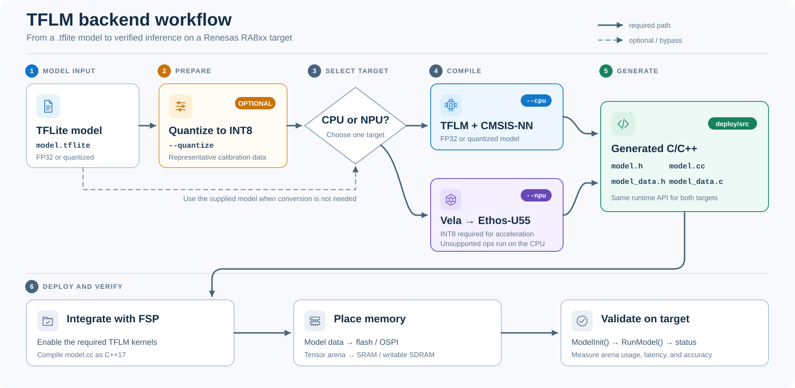

# RUHMI Framework AI Compiler for MCU — TFLM Backend

**Robust Unified Heterogeneous Model Integration** - A framework for AI model optimization and deployment. This repository provides the TensorFlow Lite for Microcontrollers (TFLM) backend of the RUHMI Framework AI MCU Compiler for Renesas embedded platforms.

[](LICENSE.md)
[]()
[]()

> [!NOTE]
> A successful compile does not prove correct inference, full NPU offload, memory fit, or target performance. Always build, run, and measure the generated code on your target board before relying on it.

## Introduction

RUHMI Framework provides a compiler and the necessary tools to convert machine learning models into source code for Renesas RA8xx MCUs, with optional acceleration on the Arm Ethos-U55 NPU of the RA8P1.

The TFLM backend takes a `.tflite` model, optionally quantizes it to INT8, and compiles it either for the Cortex-M CPU (TFLM with CMSIS-NN) or for the Ethos-U55 NPU (Arm Vela). It then generates four C/C++ files that integrate with Renesas FSP and e² studio. The model runs on the TensorFlow Lite for Microcontrollers interpreter, and both targets share the same small runtime API.

## RUHMI Framework TFLM Workflow



## Quick Start

Get up and running in 6 steps (Ubuntu Linux / WSL):

```bash
# 1. Clone the repository
git clone https://github.com/renesas/ruhmi-mcu-tflm.git
cd ruhmi-mcu-tflm

# 2. Create and activate virtual environment
python3.10 -m venv tflm-env
source tflm-env/bin/activate

# 3. Install dependencies
pip install --upgrade pip
pip install -r requirements-tflm.txt

# 4. Download a sample model
wget https://raw.githubusercontent.com/mlcommons/tiny/master/benchmark/training/anomaly_detection/trained_models/ad01_int8.tflite
mkdir -p models_int8 && mv ad01_int8.tflite models_int8/

# 5. Deploy the model to C/C++ code
python scripts/mcu_compile_tflm.py models_int8 deploy_output --npu

# 6. Check Model Metrics
python scripts/utils/check_model_metrics_tflm.py deploy_output/ad01_int8_NPU_tflm
```

Your generated source code will be in `deploy_output/ad01_int8_NPU_tflm/deploy/src/`.

📖 For detailed installation instructions, including Windows, see the [Installation Guide](install/README.md).

### Common Commands

Replace `model.tflite`, `model_int8.tflite`, and `calibration/` with your own files. Prepare the calibration data from real model inputs; see [Calibration data](docs/tflm_backend/README.md#7-calibration-data-and-quantization-quality). To try the compiler first, use the Quick Start sample model.

```bash
# CPU
python scripts/mcu_compile_tflm.py model.tflite deploy_output --cpu

# NPU, model already INT8
python scripts/mcu_compile_tflm.py model_int8.tflite deploy_output --npu

# NPU, quantize FP32 to INT8 with calibration data
python scripts/mcu_compile_tflm.py model.tflite deploy_output --npu --quantize --calib-data calibration/
```

## Supported Embedded Platforms

- Renesas MCU RA8P1 series — CPU (Cortex-M85) and NPU (Ethos-U55)
- Renesas MCU RA8xx series (non-NPU devices) — CPU

## Installation

The TFLM backend supports Ubuntu Linux and Windows. The table below outlines the prerequisites for each platform.

| Requirement | Ubuntu Linux | Windows |
|-------------|--------------|----------|
| **OS Version** | Ubuntu 22.04 (recommended), Ubuntu 24.04 | Windows 10 or 11 (11 recommended) |
| **Python** | Python 3.10.x via PyEnv or venv | Python 3.10.x via PyEnv or venv |
| **Additional** | — | Microsoft Visual C++ Redistributable (required by TensorFlow; often already installed) |
| **Target build** | e² studio with Renesas FSP | e² studio with Renesas FSP |

> [!NOTE]
> The TFLM backend has been tested and validated with **Renesas FSP 6.6.0**, using the TFLM, CMSIS-NN, and Arm Ethos-U stacks bundled with FSP. Other FSP versions may work but have not been validated.

📖 For detailed installation instructions, refer to the [Installation Guide](install/README.md).

## Model Compilation

The compiler `scripts/mcu_compile_tflm.py` handles quantization (if requested), NPU compilation, and C/C++ generation in one command.

**Capabilities:**
-   **Deploy Pre-Quantized Models**: Convert INT8 `.tflite` models directly to C/C++ for the CPU or the NPU.
-   **Deploy FP32 Models**: Convert FP32 `.tflite` models to C/C++ for the CPU.
-   **Quantize & Deploy**: Convert FP32 models to INT8 using calibration data, with an automatic quantization quality report.
-   **Platform Support**: Target the CPU (TFLM + CMSIS-NN) or the NPU (Ethos-U55 via Arm Vela).
-   **Batch and Config Modes**: Compile a whole folder of models, drive the compiler from a YAML file, and write JUnit XML results.

📖 [Detailed guide on model compilation](docs/tflm_backend/README.md)

## Guide to the Generated Source Code

Processing a model produces four integration files under `<model_output_directory>/deploy/src/`:

| File | Description |
|------|-------------|
| `model.h` | Runtime API called by your application |
| `model.cc` | TFLM interpreter setup and API implementation (compile as C++17) |
| `model_data.h` | Declaration of the model byte array |
| `model_data.c` | The model itself, stored as a byte array |

Your application calls `ModelInit()` once, writes the input through `GetModelInputPtr_<tensor>()`, calls `RunModel(false)`, checks `GetLastInvokeStatus()`, and reads the result through `GetModelOutputPtr_<tensor>()`.

📖 [Guide to the generated runtime API](docs/tflm_backend/README.md#10-runtime-api)

### Validating on Target

Before relying on a deployment, check on the target board that:

- The project builds with your FSP configuration (`model.cc` as C++17).
- `ModelInit()` and `RunModel()` succeed.
- A known input gives the expected output, and accuracy after quantization is acceptable.
- Model data and the tensor arena fit the final memory budget.
- For NPU builds, you know which operators fall back to the CPU.
- Measured latency meets your requirement.

## Inference Benchmark

A ready-to-import EK-RA8P1 e² studio project is provided to measure inference latency and check arena usage and runtime status on real hardware.

📖 [TFLM benchmark guide](docs/benchmark/README.md)

## Application Examples

Prebuilt Intel HEX images are available for five EK-RA8P1 camera and LCD use cases: face detection, image classification, palm detection, palm detection with hand landmark extraction, and the complete palm detection, hand landmark extraction, and gesture recognition pipeline. Application source and importable e² studio project ZIPs are provided for face detection, image classification, and the complete hand gesture pipeline; the other two use cases are HEX-only.

- [Setup overview and demo media](application_examples/README.md)
- [Quick Deploy with Renesas Flash Programmer](application_examples/quick_deploy/README.md)

## Documentation

| Document | Description |
|----------|-------------|
| [Installation Guide](install/README.md) | Host environment setup for Linux and Windows |
| [TFLM Backend Guide](docs/tflm_backend/README.md) | Compiler options, YAML mode, calibration, generated output, FSP integration, runtime API, memory placement, metrics, troubleshooting, and limitations |
| [Inference Benchmark](docs/benchmark/README.md) | EK-RA8P1 latency measurement and runtime diagnostics |
| [Application Examples](application_examples/README.md) | EK-RA8P1 setup, camera/LCD examples, and demo media |
| [Quick Deploy](application_examples/quick_deploy/README.md) | Available source projects, prebuilt HEX images, and RFP programming instructions |
| [Scripts](scripts/README.md) | Overview of the compiler and the metrics utility |
| [Known Issues](docs/known_issues/README.md) | Known runtime problems, affected environments, and workarounds |
| [License](LICENSE.md) | Licensing of the compiler, generated code, benchmark, application examples, media, and dependencies |

## Repository Layout

```
scripts/                  TFLM compiler (mcu_compile_tflm.py)
application_examples/     EK-RA8P1 application sources and project ZIPs
application_examples/quick_deploy/  Prebuilt HEX images and RFP guides
scripts/utils/            Model metrics utility (check_model_metrics_tflm.py)
docs/tflm_backend/        TFLM backend guide
docs/benchmark/           EK-RA8P1 benchmark project and guide
docs/known_issues/        Known issues and interim guidance
docs/assets/              Documentation images
install/                  Installation guide
requirements-tflm.txt     Python dependencies
```

## Inquiries

If you have any questions, please contact [Renesas Technical Support](https://www.renesas.com/support).
