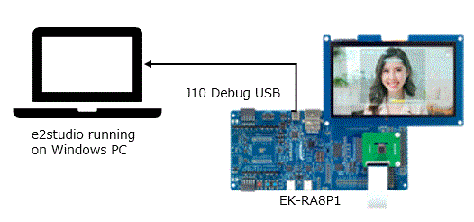
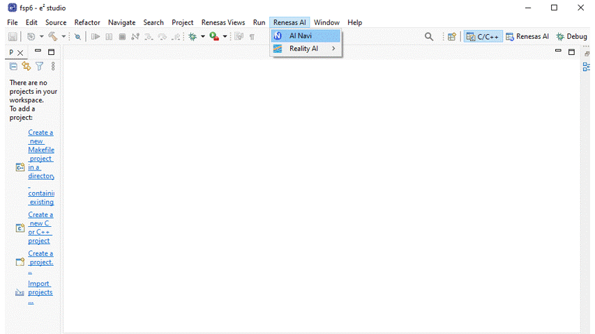
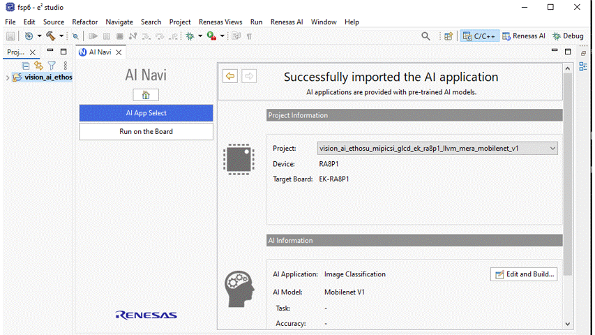
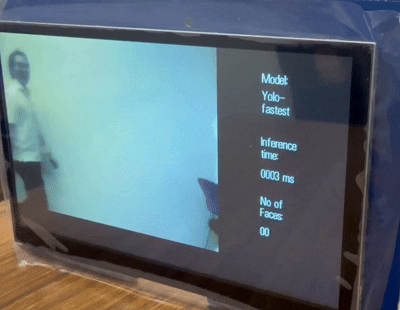
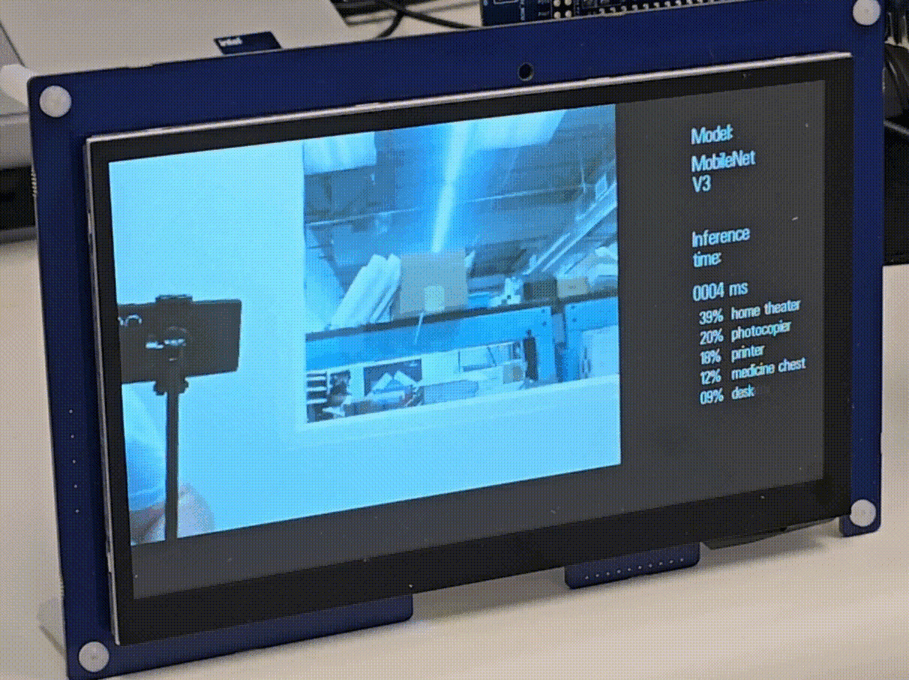
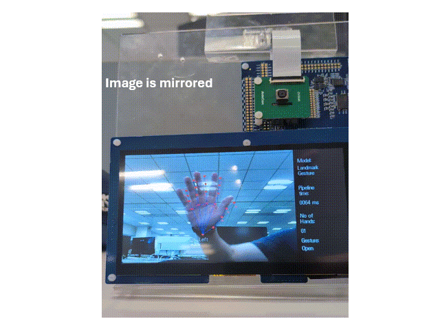

# EK-RA8P1 Quick Setup Overview  

## Preparing EK-RA8P1 and the system configuration  

### Hardware Requirements  

- [EK-RA8P1 board](https://www.renesas.com/en/design-resources/boards-kits/ek-ra8p1)
- OV5640 Camera module
- Display
- USB-C cable
- A PC with at least 1 USB port

### Software Requirements  

- Windows® 10 or 11 operating system 
- **e² studio version**: 2026-07
- **Flexible Software Package (FSP)**: 6.6.0  

### AI runtime  
The released application examples run on the TensorFlow Lite for Microcontrollers (TFLM) interpreter, with Ethos-U55 NPU acceleration for supported operators. The model code is generated by the RUHMI Framework TFLM backend. Build, run and measure the generated code on your board before relying on it.  

The palm detection model includes two CPU Gather operators. In the Palm detection + Hand landmark + Gesture recognition example, the gesture classifier runs in FP32 on the CPU.

### Connecting and Powering Up the EK-RA8P1 Board  

1.	Attach the Camera module   
2.	Attach the display  
3.	Connect the USB-C cable to USB-C (J10) of the EK-RA8P1 board.  
4.	Connect the other end of this cable to the USB port of the host PC. When powered, the white LED near the center of the board (the “dash” in the EK-RA8P1 name) will light up.   

## Downloading sample AI Application and run  

The latest source projects and prebuilt HEX images are listed in [Quick Deploy](quick_deploy/README.md#available-examples).

### Launch AI Navigator and Import sample AI Application.  

 

> ⚠️ **FSP 6.6.0 known issue:** Debug may fail with `Cannot find smart bundle`. Try either solution below.
>
> **Solution 1** 
> Re-import using **Rename & Import Existing C/C++ Project Into Workspace**.
>
> **Solution 2** 
> Right-click the project → **Properties > C/C++ Build > Refresh Policy**. If an unrelated project (such as face detection) is listed, select that entry, click **Delete...**, then **Apply and Close**, and retry debugging.

 
### Compile the sample application and load artifact to EK-RA8P1

  

## Demo movies  

<table>
  <tr>
    <td align="center">
      <h3>Face detection</h3>
      
    </td>
  </tr>
  <tr>
    <td align="center">
      <h3>Image classification</h3>
      
    </td>
  </tr>
  <tr>
    <td align="center">
      <h3>Hand landmark</h3>
      
    </td>
  </tr>
</table>
