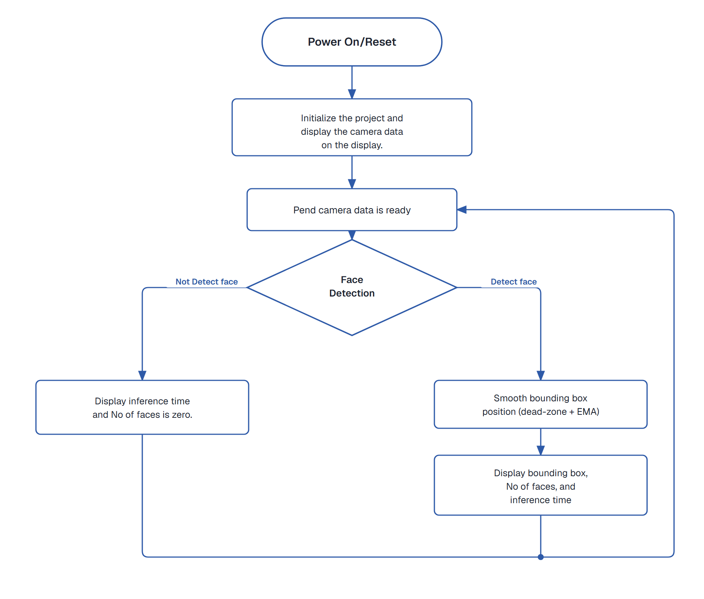
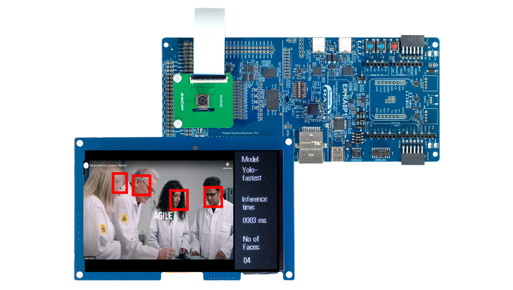

# Introduction

This demo project showcases real-time face detection on a Renesas RA8 microcontroller using the RUHMI Framework TFLM backend. A camera captures images, and a lightweight neural network (YOLO-fastest) detects faces in real time. The model runs on the TensorFlow Lite for Microcontrollers (TFLM) interpreter and is accelerated by the on-chip Arm Ethos-U NPU. Results are displayed on an LCD with bounding boxes around detected faces.

Use the [.zip file](../ek_ra8p1_vision_face_detection_yolo_fastest_TFLM_FSP660.zip) when you import the application project into e² studio.

---

## Overview

The system captures camera frames, detects faces, and draws bounding boxes over detected regions. The primary goal is to demonstrate efficient AI processing using the Ethos-U NPU on an embedded platform with real-time constraints.

| No | Content | Description |
| --- | --- | --- |
| 1 | AI Model | YOLO-fastest |
| 2 | Inference time | Displays inference time in milliseconds |
| 3 | Num of face | Count of detected faces |

<div align="center">
  
</div>

---

## Hardware Setup

- **Evaluation Kit**: Renesas **EK-RA8P1**
- **Camera & Display**: Integrated in the EK-RA8P1 kit
- **NPU**: On-board **Arm Ethos-U** (no external setup required)
- **Connection to PC**: Connect **DEBUG1 USB-C (J10)** to the PC for debugging; provide the required board/display power
- **Important**: Ensure the **SW4 switch (middle of the board)** is set to all **0** (OFF)

---

## Software Setup

- **e² studio version**: 2026-07
- **Flexible Software Package (FSP)**: 6.6.0
- **Toolchain**: LLVM/Clang (ATfE 22.1.0) is the toolchain this project is configured to build with by default.
- **RTOS**: FreeRTOS (via FSP's `rtos.awsfreertos` module)
- **AI runtime**: TensorFlow Lite for Microcontrollers (TFLM) with the Ethos-U kernel, provided by the FSP components `Google TFLM Core Lib`, `Google TFLM Ethos-U Kernel` and `Google TFLM CMSIS-NN Kernel` (already configured in `configuration.xml`)
- **Model code**: Generated by the RUHMI Framework TFLM backend (`mcu_compile_tflm.py`) and included in `src/ai_application/tflm_model/`

## How to Compile and Flash

1. **Install e² studio**
2. **Connect your EK-RA8P1 board** via USB Type-C
3. **Download and extract this repository**, or download the project ZIP linked above (no extraction required).
4. **Open e² studio** and import the project: **File > Import > Existing Projects into Workspace**<br>
   For a ZIP, choose **Select archive file** and select the project ZIP.
   > **FSP 6.6.0 known issue:** if Debug later fails with `Cannot find smart bundle`, re-import using **Rename & Import Existing C/C++ Project Into Workspace** instead.
5. **Generate drivers**: open `configuration.xml` and select **Generate Project Content**.
6. **Build the project**: right-click the project in the left sidebar and select **Build Project**.
7. **Flash to the board**: right-click the project and select **Debug As > Renesas GDB Hardware Debugging**.
8. **Run**: click **Resume** a few times.

For quick programming with a prebuilt image, see [Quick Deploy](../quick_deploy/README.md).

---
## Key Source Code

Main AI inference logic is in:  
`src/ai_application/face_detection/MainLoop_obj.cc` (`main_loop_face_detection()`)

TFLM model initialization (`ModelInit()`, called once after the Ethos-U driver is opened) is in:  
`src/ai_inference_thread_entry.c` (`ai_inference_thread_entry()`) → `src/ai_application/common/Main.cc` (`face_detection_init()`)

Adapter between the application and the generated TFLM runtime API is in:  
`src/ai_application/face_detection/wrapper.h`

Generated TFLM model code (runtime API, tensor arena and model data) is in:  
`src/ai_application/tflm_model/` (`model.h`, `model.cc`, `model_data.h`, `model_data.c`)

Detection result update/smoothing is in:  
`src/ai_inference_thread_entry.c` (`update_detection_result()`)

Display/UI rendering is in:  
`src/display_layer/face_detection_screen_mipi.c`

---
## Code Explanation

```cpp
return (0 == model_init()) ? VISION_AI_APP_SUCCESS : VISION_AI_APP_ERR_AI_INIT;
```
Initializes the TFLM interpreter once at startup (`ModelInit()`): registers the Ethos-U operator and allocates the tensor arena. It must be called after `RM_ETHOSU_Open()`.
The `? :` is the C ternary operator, a one-line `if/else`: it returns `VISION_AI_APP_SUCCESS` if `model_init()` returns 0, otherwise `VISION_AI_APP_ERR_AI_INIT`.

```cpp
memcpy(model_input_ptr(), model_buffer_int8, IMAGE_DATA_SIZE);
```
Copies the preprocessed input image into the model input tensor.

```cpp
volatile uint32_t old_counter = TimeCounter_CurrentCountGet();
const int invoke_status = model_invoke();
application_processing_time.ai_inference_time_ms = TimeCounter_CountValueConvertToMs(old_counter, TimeCounter_CurrentCountGet());
```
Runs one inference (`RunModel(false)`), measures the inference time in milliseconds, and returns `GetLastInvokeStatus()` (0 on success).

```cpp
int8_t* output0 = (int8_t*)model_output0_ptr();
int8_t* output1 = (int8_t*)model_output1_ptr();
```
Gets pointers to the two model output tensors used by post-processing: `Identity` (6x6 grid) and `Identity_1` (12x12 grid). Their scale and zero point come from the `OUTPUT_SCALE_*` / `OUTPUT_ZERO_POINT_*` macros in the generated `model.h`.

---

## Results & Performance

| Mode | Inference Time | Notes |
| --- | --- | --- |
| Ethos-U enabled (TFLM) | ~4ms | NPU-accelerated inference, 108/108 operators on the NPU |

## Model reference

The model used in this project is YOLO-fastest-192 (`yolo-fastest_192_face_v4.tflite`), downloadable from [here](https://github.com/emza-vs/ModelZoo/tree/master/object_detection).

The files in `src/ai_application/tflm_model/` were generated with the RUHMI Framework TFLM backend:

```bash
python scripts/mcu_compile_tflm.py yolo-fastest_192_face_v4.tflite deploy_output --npu
```

Copy the four files from `deploy_output/yolo-fastest_192_face_v4_NPU_tflm/deploy/src/` into `src/ai_application/tflm_model/`. After regenerating, re-apply the memory placement blocks in `model_data.c` (`AI_MODEL_ALLOCATION`) and `model.cc` (`TENSOR_ARENA_ALLOCATION`), which select the memory section from `src/application_config.h`.
