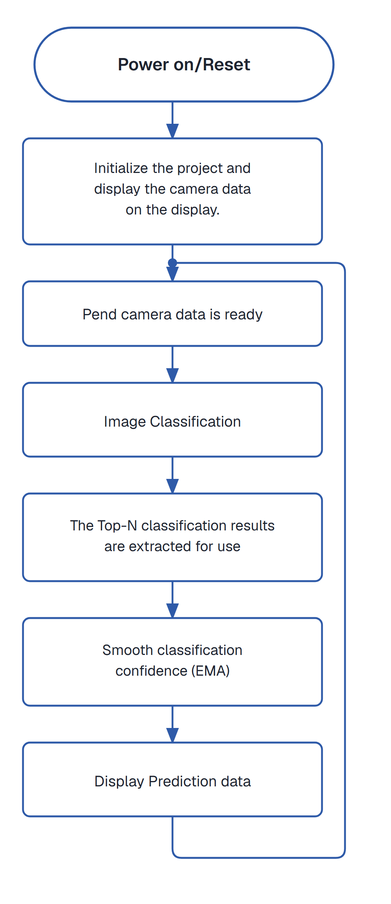
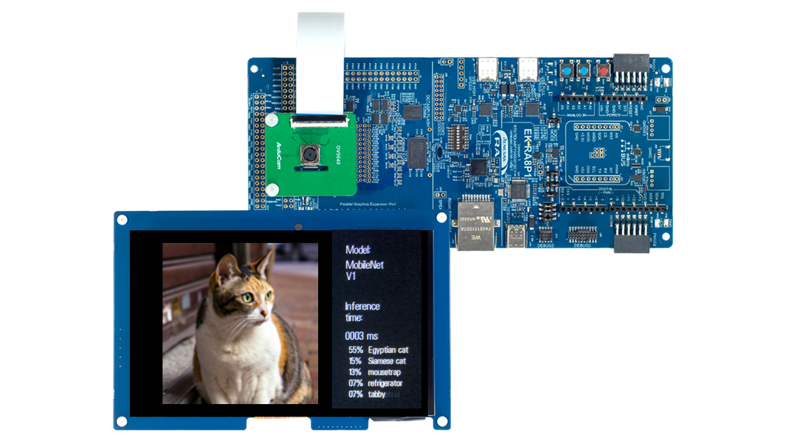

# Introduction

This demo showcases an image classification application using MobileNet V1 on the Renesas EK-RA8P1 board with Arm Ethos-U NPU support. It leverages the RUHMI Framework TFLM backend for efficient model deployment. Real-time inference is performed on camera input, and the Top-5 classification results are displayed on an LCD, demonstrating low-power, high-performance edge AI on an embedded platform.

Use the [.zip file](../ek_ra8p1_vision_image_classification_mobilenet_v1_TFLM_FSP660.zip) when you import the application project into e² studio.

---

## Overview

This demo performs real-time image classification on captured camera frames, using a MobileNet V1 model trained on the ImageNet dataset (1000 classes). The Top-5 predicted classes, with their confidence scores, are displayed on the screen.

| No | Content | Description |
| --- | --- | --- |
| 1 | AI Model | MobileNet V1 |
| 2 | Inference time | Displays inference time in milliseconds |
| 3 | Top-5 accuracy | The Top-5 predicted class labels along with their confidence scores |

<div align="center">
  
</div>

---

## Hardware Setup

- **Evaluation Kit**: Renesas **EK-RA8P1**
- **Camera & Display**: Integrated in the EK-RA8P1 kit
- **NPU**: On-board **Arm Ethos-U** (no external setup required)
- **Connection to PC**: Connect **DEBUG1 USB-C (J10)** to the PC for debugging; provide the required board/display power
- **Important**: Ensure the **SW4 switch (middle of the board)** is set to all **0** (OFF)

---

## Software Setup

- **e² studio version**: 2026-07
- **Flexible Software Package (FSP)**: 6.6.0
- **Toolchain**: LLVM/Clang (ATfE 22.1.0) is the toolchain this project is configured to build with by default.
- **RTOS**: FreeRTOS (via FSP's `rtos.awsfreertos` module)
- **AI runtime**: TensorFlow Lite for Microcontrollers (TFLM) with the Ethos-U kernel, provided by the FSP components `Google TFLM Core Lib`, `Google TFLM Ethos-U Kernel` and `Google TFLM CMSIS-NN Kernel` (already configured in `configuration.xml`)
- **Model code**: Generated by the RUHMI Framework TFLM backend (`mcu_compile_tflm.py`) and included in `src/ai_application/tflm_model/`
- **Model**: MobileNet V1, quantized INT8, 1000-class ImageNet output

## How to Compile and Flash

1. **Install e² studio**
2. **Connect your EK-RA8P1 board** via USB Type-C
3. **Download and extract this repository**, or download the project ZIP linked above (no extraction required).
4. **Open e² studio** and import the project: **File > Import > Existing Projects into Workspace**<br>
   For a ZIP, choose **Select archive file** and select the project ZIP.
   > **FSP 6.6.0 known issue:** if Debug later fails with `Cannot find smart bundle`, re-import using **Rename & Import Existing C/C++ Project Into Workspace** instead.
5. **Generate drivers**: open `configuration.xml` and select **Generate Project Content**.
6. **Build the project**: right-click the project in the left sidebar and select **Build Project**.
7. **Flash to the board**: right-click the project and select **Debug As > Renesas GDB Hardware Debugging**.
8. **Run**: click **Resume** a few times.

For quick programming with a prebuilt image, see [Quick Deploy](../quick_deploy/README.md).

---

## Key Source Code

Main AI inference logic is in:  
`src/ai_application/image_classification/MainLoop_img.cc` (`main_loop_image_classification()`)

TFLM model initialization (`ModelInit()`, called once after the Ethos-U driver is opened) is in:  
`src/ai_inference_thread_entry.c` (`ai_inference_thread_entry()`) calls `src/ai_application/common/Main.cc` (`image_classification_init()`)

Adapter between the application and the generated TFLM runtime API is in:  
`src/ai_application/image_classification/wrapper.h`

Generated TFLM model code (runtime API, tensor arena and model data) is in:  
`src/ai_application/tflm_model/` (`model.h`, `model.cc`, `model_data.h`, `model_data.c`)

Classification result smoothing is in:  
`src/ai_inference_thread_entry.c` (`update_classification_result()`)

Display/UI rendering is in:  
`src/display_layer/image_classification_screen_mipi.c` (`do_image_classification_screen()`)

---

## Code Explanation

```cpp
const int status = model_init();
```
Initializes the TFLM interpreter once at startup (`ModelInit()`): registers the Ethos-U operator and allocates the tensor arena. It must be called after `RM_ETHOSU_Open()`. The adapter also validates the input/output tensor contracts; `image_classification_init()` reports an initialization error if the returned status is nonzero.

```cpp
copy_data_to_model(model_input_ptr(), reinterpret_cast<const uint8_t*>(model_buffer_int8), model_input_size());
```
Copies the RGB888 image into the model input tensor, converting each unsigned pixel value with the original `pixel - 128` preprocessing.

```cpp
const uint32_t old_counter = TimeCounter_CurrentCountGet();
const bool inference_ok = model_invoke();
const uint32_t new_counter = TimeCounter_CurrentCountGet();
application_processing_time.ai_inference_time_ms = TimeCounter_CountValueConvertToMs(old_counter, new_counter);
```
Runs one inference (`RunModel(false)`) and measures its time in milliseconds. Unlike the face detection adapter's integer status, this adapter returns `true` when `GetLastInvokeStatus()` is 0. Results are not published if inference fails.

```cpp
TfLiteTensor* outputTensor = model_output_tensor();
```
Gets the output tensor used by post-processing, including its actual quantization parameters. The generated [model.h](src/ai_application/tflm_model/model.h) also provides `OUTPUT_SCALE_STATEFULPARTITIONEDCALL_0` and `OUTPUT_ZERO_POINT_STATEFULPARTITIONEDCALL_0`. The Top-5 results are then smoothed by class ID and displayed.

---

## Results & Performance

| Mode | Inference Time | Notes |
| --- | --- | --- |
| Ethos-U enabled (TFLM) | ~2ms | NPU-accelerated inference, 57/57 operators on the NPU |

## Model reference

The model used in this project is MobileNet V1, quantized to INT8 with a 1000-class (ImageNet) output, referenced from [here](https://github.com/tensorflow/models/blob/master/research/slim/nets/mobilenet_v1.md).

The files in `src/ai_application/tflm_model/` were generated with the RUHMI Framework TFLM backend. The source model is `model/mobilenet_v1_int8.tflite` in the complete project ZIP. From the backend directory, use the extracted project's model path:

```bash
python scripts/mcu_compile_tflm.py /path/to/extracted_project/model/mobilenet_v1_int8.tflite deploy_output --npu
```

Copy the four files from `deploy_output/mobilenet_v1_int8_NPU_tflm/deploy/src/` into `src/ai_application/tflm_model/`. After regenerating, re-apply the model placement blocks in `model_data.c` and `model_data.h` (`AI_MODEL_ALLOCATION`) and the arena placement block in `model.cc` (`TENSOR_ARENA_ALLOCATION`), which select the memory section from `src/application_config.h`.
