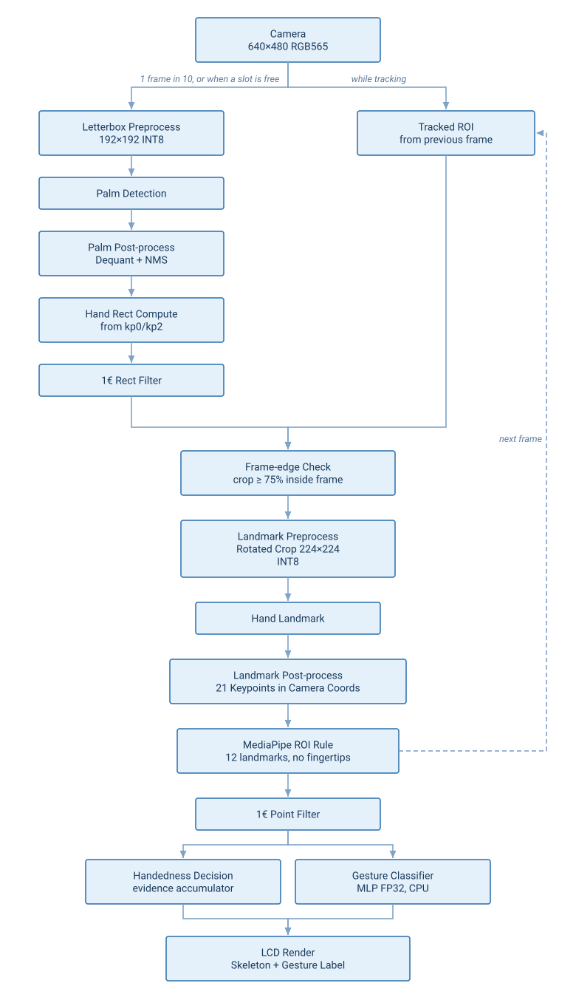
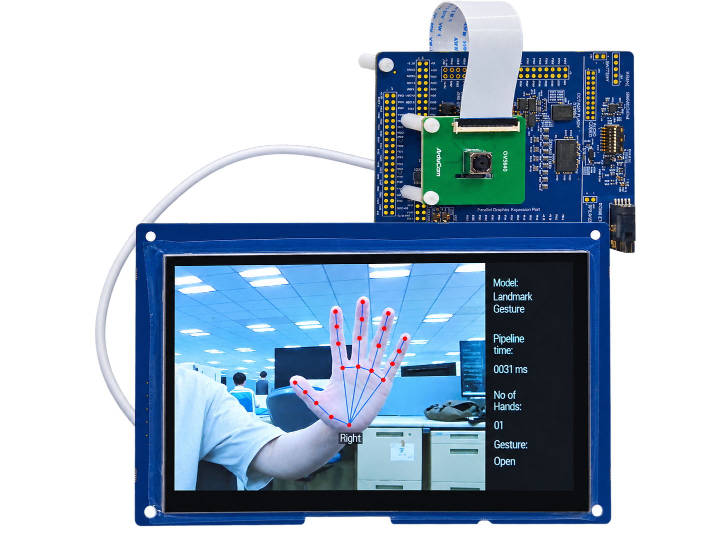

# Introduction
This demo project showcases a complete hand gesture recognition pipeline on a Renesas RA8P1 MCU using TensorFlow Lite for Microcontrollers (TFLM) and models compiled with the RUHMI Framework AI MCU Compiler. It combines palm detection, hand landmark extraction, and an MLP-based gesture classifier to recognize hand gestures in real time. The system supports up to 2 hands and displays gesture labels with a hand skeleton overlay on an LCD.

Use the [source project ZIP](../ek_ra8p1_vision_palm_detection_hand_landmarkmodel_gesture_recognition_camera_LCD_TFLM_FSP660.zip) when importing this application into e² studio.

---

## Overview
The system runs a three-stage pipeline: palm detection finds hands, the landmark model extracts 21 keypoints, and a lightweight classifier predicts gestures from normalized keypoints. While a hand is tracked, the ROI is re-derived from landmarks, so palm detection runs periodically instead of every frame.

| No | Content | Description |
|----|---------|-------------|
| 1 | AI Models | Palm Detection INT8 + Hand Landmark INT8 + Keypoint Classifier FP32 |
| 2 | Max Hands | 2 |
| 3 | Gestures | Open, Close, Pointer |
| 4 | Camera frame period | 26ms (38 fps), fixed |

## Architectural Diagram

<div align="center">

</div>

---

## Hardware Setup
- **Evaluation Kit**: Renesas **EK-RA8P1**
- **Camera & Display**: Integrated in the EK-RA8P1 kit
- **NPU**: On-board **Arm Ethos-U55** (no external setup required)
- **Connection to PC**: Connect **DEBUG1 USB-C (J10)** to the PC for debugging; provide the required board/display power
- **Important**: Ensure the **SW4 switch (middle of the board)** is set to all **0** (OFF)

## Software Setup

- **e² studio version**: 2026-07
- **Flexible Software Package (FSP)**: 6.6.0
- **Toolchain**: LLVM/Clang (ATfE 22.1.0) is the toolchain this project is configured to build with by default.
- **RTOS**: FreeRTOS (via FSP's `rtos.awsfreertos` module)
- **AI runtime**: TensorFlow Lite for Microcontrollers (TFLM) with the Ethos-U kernel, provided by the FSP components `Google TFLM Core Lib`, `Google TFLM Ethos-U Kernel` and `Google TFLM CMSIS-NN Kernel` (already configured in `configuration.xml`)
- **Model code**: Generated by the RUHMI Framework TFLM backend (`mcu_compile_tflm.py`) and included in `src/ai_application/tflm_palm/`, `src/ai_application/tflm_landmark/`, and `src/ai_application/tflm_gesture/`

Palm detection and hand landmark inference use the Ethos-U55 NPU; palm detection also includes two CPU Gather operators. The gesture classifier remains FP32 on the CPU. The two vision models share a non-persistent tensor workspace and retain separate persistent state. The classifier has an independent arena because it runs in the display thread.

The default model placement stores the palm and landmark models in external OSPI flash and copies them to SDRAM at startup. Use the supplied debug configuration with external-flash programming enabled.

> **Note:** In Release builds, the demo may require one manual board reset after flashing (or power-cycle) before it runs correctly.

## How to Compile and Flash

1. **Install e² studio**
2. **Connect your EK-RA8P1 board** via USB Type-C
3. **Download and extract this repository**, or download the project ZIP linked above (no extraction required).
4. **Open e² studio** and import the project: **File > Import > Existing Projects into Workspace**<br>
   For a ZIP, choose **Select archive file** and select the project ZIP.
   > **FSP 6.6.0 known issue:** Debug may fail with `Cannot find smart bundle`. Try either solution below.
   >
   > **Solution 1**<br>
   > Re-import using **Rename & Import Existing C/C++ Project Into Workspace**.
   >
   > **Solution 2**<br>
   > Right-click the project → **Properties > C/C++ Build > Refresh Policy**. If an unrelated project (such as face detection) is listed, select that entry, click **Delete...**, then **Apply and Close**, and retry debugging.
5. **Generate drivers**: open `configuration.xml` and select **Generate Project Content**.
6. **Build the project**: right-click the project in the left sidebar and select **Build Project**.
7. **Flash to the board**: right-click the project and select **Debug As > Renesas GDB Hardware Debugging**.
8. **Run**: click **Resume** a few times.

For quick programming with a prebuilt image, see [Quick Deploy](../quick_deploy/README.md).

---

## Board Controls

| Control | Action |
|---------|--------|
| **SW2** | Pause / resume the whole recognition pipeline |

---
## Key Source Code

Main AI pipeline logic is in:  
`src/ai_application/palm_detection/MainLoop_obj.cc` (`main_loop_palm_detection()`)

TFLM initialization and model input/output validation are in:  
`src/ai_application/tflm_init.cc` (`palm_detection_init()`)

TFLM model wrappers and compiled model data are in:  
`src/ai_application/tflm_palm/`, `src/ai_application/tflm_landmark/`, and `src/ai_application/tflm_gesture/`

The shared non-persistent vision workspace is defined in:  
`src/ai_application/tflm_memory.cc`

Detection/landmark shared result update is in:  
`src/ai_inference_thread_entry.c` (`update_detection_result()`, `update_landmark_result()`)

Gesture classification is in:  
`src/ai_application/palm_detection/gesture_classify.c` (`gesture_classify()`)

Display/UI rendering is in:  
`src/display_layer/detection_screen_mipi.c` (`do_detection_screen()`)

---
## Code Explanation

```cpp
memcpy(palm_input_ptr(), model_buffer_int8, IMAGE_DATA_SIZE);
if (palm_invoke() != 0) {
    error("Palm detection inference failed.");
    return false;
}
```
Copies palm-detector input into the tensor buffer and runs TFLM inference. Cache maintenance is performed at each NPU hand-off by the FSP Ethos-U driver. Inference errors are reported without publishing an updated detection result.

```cpp
int8_t* out_scores = palm_output_scores_ptr();
int8_t* out_boxes  = palm_output_boxes_ptr();
int8_t* out_kp0    = palm_output_kp0_ptr();
int8_t* out_kp2    = palm_output_kp2_ptr();
```
Gets palm model output tensors for post-processing. The dequantization parameters are taken from the deployed model headers.

```cpp
update_handedness(i);
update_gesture(i);
draw_landmark_points(i);
```
Updates handedness/gesture once per inference result and draws landmark overlays.

### Model compilation

The original source models are included in `model/` inside the complete source project ZIP. From the RUHMI TFLM backend environment, run:

```bash
python scripts/mcu_compile_tflm.py /path/to/project/model/palm_detection_full_inf_post_192x192_pre_nms_negfix_INT8.tflite deploy_output --npu --suffix palm
python scripts/mcu_compile_tflm.py /path/to/project/model/hand_landmark_sparse_Nx3x224x224_noround_int8.tflite deploy_output --npu --suffix landmark
python scripts/mcu_compile_tflm.py /path/to/project/model/keypoint_classifier.tflite deploy_output --cpu --suffix gesture
```

Each deployment contains four files under `deploy/src/`. When updating these files, retain the application-specific quantization macro prefixes, memory-placement sections, shared/non-persistent arena configuration, tensor accessors, and initialization/inference guards.

---

## Results & Performance

| Stage | Time (ms) | Notes |
|-------|-----------|-------|
| Camera frame period | ~26 | Fixed |
| LCD refresh period | ~28 | Measured on EK-RA8P1 |
| AI pipeline total (0 hands) | ~38 | Detector runs every frame while nothing is tracked |
| AI pipeline total (1 hand) | ~62 | Palm detection + one landmark inference |
| AI pipeline total (2 hands) | ~86 | Palm detection + two landmark inferences |
| Gesture classification (CPU) | <0.1 | Runs separately in the display thread |

The LCD shows the pipeline time of the latest completed detection frame and retains it during tracking-only frames. This is not pure model inference time or end-to-end latency.

## Gesture Classes

| Gesture | Description |
|---------|-------------|
| Open | All fingers extended |
| Close | Fist / all fingers closed |
| Pointer | Index finger extended, others closed |

## Example output

<div align="center">

</div>

## Reference

The temporal filtering used in this application is an independent implementation of the 1€ Filter algorithm described in:

Géry Casiez, Nicolas Roussel, and Daniel Vogel, “1€ Filter: A Simple Speed-Based Low-Pass Filter for Noisy Input in Interactive Systems,” Proceedings of CHI 2012, pp. 2527–2530.  
https://doi.org/10.1145/2207676.2208639

The implementation in this project was independently written from the algorithm described in the paper. No source code from the reference implementations is incorporated.

Models are based on [hand-gesture-recognition-using-onnx](https://github.com/PINTO0309/hand-gesture-recognition-using-onnx) by Kazuhito Takahashi / PINTO0309 (Apache-2.0), originally derived from MediaPipe by Google LLC.

- **Palm Detection**: MediaPipe Palm Detection Full
- **Hand Landmark**: MediaPipe Hand Landmark Sparse
- **Keypoint Classifier**: MLP gesture classifier (Open/Close/Pointer)

The palm detection and hand landmark models have been optimized and quantized (INT8) by Renesas to run efficiently on the EK-RA8P1 Ethos-U55 NPU.

> Note: This example is provided as a demo. The model has not been retrained or fine-tuned for improved accuracy and is provided as-is.
