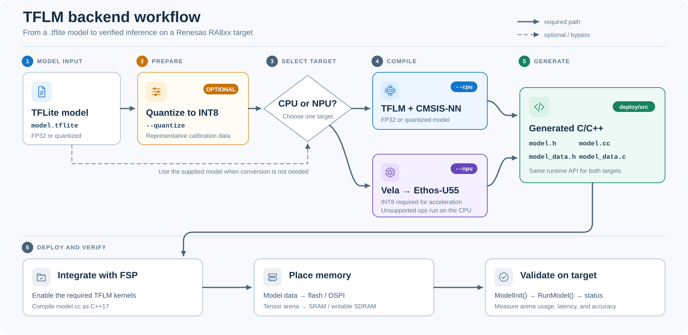

# TFLM Backend Guide

> [!NOTE]
> Always validate the generated code on your target board. A successful compile does not prove correct inference, memory fit, or target performance.

---

## Table of contents

1. [Overview](#1-overview)
2. [Supported targets](#2-supported-targets)
3. [Installation](#3-installation)
4. [Command-line usage](#4-command-line-usage)
   - [Vela optimization strategy: Size vs. Performance](#vela-optimization-strategy-size-vs-performance)
5. [YAML config mode](#5-yaml-config-mode)
6. [Compilation examples](#6-compilation-examples)
7. [Calibration data and quantization quality](#7-calibration-data-and-quantization-quality)
8. [Generated output](#8-generated-output)
9. [FSP project requirements](#9-fsp-project-requirements)
10. [Runtime API](#10-runtime-api)
11. [Memory placement](#11-memory-placement)
12. [Checking model metrics](#12-checking-model-metrics)
13. [Troubleshooting](#13-troubleshooting)
14. [Known limitations](#14-known-limitations)
15. [License of generated files](#15-license-of-generated-files)

---

## 1. Overview

The TFLM backend compiles a trained `.tflite` model for Renesas RA8xx boards using **TensorFlow Lite for Microcontrollers (TFLM)**, a small open-source interpreter that runs neural networks directly on a microcontroller, with no operating system and no dynamic memory allocation.

The compiler `scripts/mcu_compile_tflm.py` turns your model into four files that you add to an e² studio project:

- `model.h` — the functions your application calls (public API)
- `model.cc` — the code that implements those functions
- `model_data.h` — declares the model data
- `model_data.c` — the model itself, stored as a byte array

The model can run in two ways: on the CPU, using CMSIS-NN kernels where possible, or on the Ethos-U55 NPU, after the compiler runs Arm Vela on it.



---

## 2. Supported targets

| Target | Description |
| --- | --- |
| **CPU** | Renesas RA8xx Cortex-M CPU, using TFLM with CMSIS-NN kernels where possible. Works with FP32 or INT8 models. |
| **NPU** | Renesas RA8P1 Ethos-U55 (256 MACs/cycle configuration), through Arm Vela and the TFLM Ethos-U kernel. |

To get real acceleration from the Ethos-U55 NPU, your model must be quantized (INT8). You can either supply a model that is already quantized, or pass `--quantize` to let the compiler do it for you. A model that is **not** quantized can still be compiled with `--npu`, but Vela leaves its non-quantized operators on the CPU, so NPU acceleration may be partial or zero.

---

## 3. Installation

Use a Python 3.10 virtual environment and install `requirements-tflm.txt`:

```bash
python3.10 -m venv tflm-env
source tflm-env/bin/activate
pip install -r requirements-tflm.txt
```

📖 For Windows, version checks, and the role of each dependency, see the [Installation Guide](../../install/README.md).

---

## 4. Command-line usage

Run the compiler from the **repository root folder**:

```bash
python scripts/mcu_compile_tflm.py <model_path> <output_dir> [options]
```

#### Positional Arguments

| Argument | Description |
| :--- | :--- |
| `model_path` | Path to a `.tflite` model file, or a folder. A folder is searched recursively for `.tflite` files, and each one is compiled into its own output folder. |
| `output_dir` | Directory where the generated artifacts will be saved. |

#### Full Argument List

| Argument | Default | Description |
| :--- | :--- | :--- |
| **Target** | | |
| `--cpu` | `False` | Compile for the Cortex-M CPU (TFLM + CMSIS-NN). |
| `--npu` | `False` | Compile for the Ethos-U55 NPU (an INT8 model is required for acceleration). |
| **Precision** | | |
| `--quantize` | `False` | Quantize an FP32 model to INT8 before deployment. A model that is already quantized is not quantized again. |
| `--calib-data` | `""` | Path to calibration data: a `.npy` file, or a folder of `.npy` files. Requires `--quantize`. |
| `--calib-num` | `5` | Number of calibration samples to use. Requires `--quantize`. |
| **Memory & Optimization** | | |
| `--external` | `False` | Force external memory mode. NPU: Vela compiles with the `Shared_Sram` memory mode. CPU: only marks the output; you place the buffers yourself. |
| `--memory-threshold` | `0.8` | Model size (MB) above which external memory mode is turned on automatically. |
| `--memory-mode` | `Sram_Only` | (NPU only) Vela memory mode. Choices: `Sram_Only`, `Shared_Sram`. |
| `--optimization` | `Performance` | (NPU only) Vela optimization target. Choices: `Performance`, `Size`. |
| **Output & Naming** | | |
| `--suffix` | `""` | Adds a suffix to generated file and function names, so several models can live in one project (see [Multiple models](#multiple-models-in-one-project)). |
| `--result` | `""` | Path to write a JUnit XML result file. |
| **Host Testing** | | |
| `--host-evaluate` | `False` | Runs the compiled model once in the desktop TFLite interpreter with random input, as a smoke test. CPU only. |
| `--version` | | Print the compiler version. |

For NPU optimization defaults and trade-offs, see [Vela optimization strategy: Size vs. Performance](#vela-optimization-strategy-size-vs-performance).

Exactly one of `--cpu` or `--npu` is required. The compiler rejects options that do not apply to the selected target — for example `--memory-mode Shared_Sram` or `--optimization Size` together with `--cpu`, `--host-evaluate` together with `--npu`, or `--calib-data` without `--quantize`. A non-zero exit code means at least one model failed.

**Output folder naming:** `{model_name}_{TARGET}_tflm[_external][_quantized][_suffix]`

- **{model_name}** — taken from the input file, without its extension. Spaces are replaced with underscores.
- **{TARGET}** — `CPU` or `NPU`.
- **_tflm** — always added.
- **_external** — added when `--external` is given or the model is larger than `--memory-threshold`. With `--quantize`, an FP32 model is compared at a quarter of its size, its expected INT8 size.
- **_quantized** — added when `--quantize` actually converts an FP32 model. An already quantized model does not get it.
- **_suffix** — the `--suffix` value, if given (see [Multiple models](#multiple-models-in-one-project)).

### Vela optimization strategy: Size vs. Performance

The NPU-only `--optimization` option selects Vela's `--optimise` strategy: `Size` or `Performance`. The corresponding YAML field is `optimization`.

**Performance** is the default when `--optimization` (or `optimization` in YAML) is omitted. It prioritizes execution speed and may allocate more tensor arena memory for weight buffering, including double-buffering. This overlaps weight transfers with NPU computation to reduce time spent waiting for weights.

**Size** prioritizes reducing runtime memory requirements. Keeping the tensor arena in on-chip SRAM can be faster than using a larger arena in external SDRAM. If the arena no longer fits in SRAM and is placed in SDRAM, slower memory accesses can outweigh the benefit of weight buffering.

**Recommendation:** Keep the `Performance` default when its arena fits within the SRAM available to your application. If it does not, try `--optimization Size` (or `optimization: Size` in YAML), and confirm on the target board which setting is faster.

The compiler does not automatically place the arena in SRAM; placement depends on the application and linker configuration. See [Memory placement](#11-memory-placement).

---

## 5. YAML config mode

Instead of typing every option on the command line, you can put them in a YAML file and pass that file as the only argument:

```bash
python scripts/mcu_compile_tflm.py my_config.yaml
```

If the first argument ends in `.yaml` or `.yml`, it is treated as a config file instead of a model path, and other command-line options are ignored.

**Example `my_config.yaml`:**

```yaml
model_path: models/model_fp32.tflite
output_dir: deploy_output
target: npu          # 'cpu' or 'npu' (required)
quantize: true
calib_data: calibration/
calib_num: 20
external: false
memory_threshold: 0.8
memory_mode: Sram_Only
optimization: Performance
suffix: ''
host_evaluate: false
result: ''
```

Each field maps to the matching command-line option above (for example, `memory_threshold` is the same as `--memory-threshold`). Only `model_path`, `output_dir`, and `target` are required; everything else falls back to its default value. Unknown keys are ignored with a warning. An optional `compiler: tflm` key is accepted; any other `compiler` value is an error. Relative paths are resolved from the folder you run the command in, not from the folder containing the YAML file.

This mode is useful for repeatable builds (for example, in CI), where you want to keep the exact compiler settings for a model in version control.

---

## 6. Compilation examples

Replace the model, calibration, and output names in these examples with your own files and folders. Prepare the calibration data from real model inputs; see [Calibration data](#7-calibration-data-and-quantization-quality). To try the compiler first, use the [Quick Start](../../README.md#quick-start) sample model.

On Windows PowerShell, put the command on one line: remove the trailing `\` and join the continued line.

### CPU, model as supplied

```bash
python scripts/mcu_compile_tflm.py model.tflite deploy_output --cpu
```

### CPU, convert FP32 to INT8

```bash
python scripts/mcu_compile_tflm.py model_fp32.tflite deploy_output --cpu --quantize \
  --calib-data calibration/ --calib-num 20
```

### RA8P1 NPU, model is already quantized (INT8)

```bash
python scripts/mcu_compile_tflm.py model_int8.tflite deploy_output --npu
```

### RA8P1 NPU, convert FP32 to INT8 with calibration data

```bash
python scripts/mcu_compile_tflm.py model_fp32.tflite deploy_output --npu --quantize \
  --calib-data calibration_inputs.npy --calib-num 20
```

### Large models (external memory)

```bash
python scripts/mcu_compile_tflm.py large_model_int8.tflite deploy_output --npu --external
```

This flag selects how Vela lays out the model. The actual memory placement still depends on your project's source code and the linker configuration generated by FSP — see [Memory placement](#11-memory-placement).

### Every model in a folder, with a JUnit report

```bash
python scripts/mcu_compile_tflm.py models_int8 deploy_output --npu --result results.xml
```

### CPU host smoke test

```bash
python scripts/mcu_compile_tflm.py model.tflite deploy_output --cpu --host-evaluate
```

This runs the model once in the desktop TFLite interpreter with random input. It confirms that the model loads and runs, but it does not execute the generated embedded code and does not check accuracy.

---

## 7. Calibration data and quantization quality

With `--quantize`, the compiler uses the TensorFlow Lite calibrator to produce a model with INT8 inputs, outputs, and activations, INT32 biases, and per-channel weights.

`--calib-data` accepts:

- a folder of `.npy` files, one sample per file, read in sorted file-name order (sub-folders are not searched). The first `--calib-num` files are used.
- a single `.npy` file. For a single-input model, the array is either one sample (the input shape, with or without its leading batch dimension of 1) or several samples stacked along a new first axis, of which the first `--calib-num` are used. Any other shape is an error. If the file holds fewer samples than `--calib-num`, the compiler warns and uses the ones available.

Each sample must match the model input's shape and value range, and must be preprocessed exactly like your real input. For a model with several inputs, each sample must be a list or tuple with one array per input, in input order, saved as a NumPy object array.

> [!CAUTION]
> For multi-input models, `.npy` files are loaded with `allow_pickle=True`. Only use calibration files from a source you trust. For single-input models, pickled files are rejected.

If `--calib-data` is not given, the compiler warns and uses random representative data. This is only meant for early bring-up and testing, and usually gives poor accuracy. A missing path, an empty folder, a non-`.npy` file, or a sample count below 1 stops the compilation with an error, instead of silently falling back to random data.

When the model is actually converted, the compiler compares the FP32 and INT8 models on the calibration samples and writes `quantization/quant_debug/model_stats.json`, with overall agreement metrics (cosine similarity, PSNR, MSE, maximum absolute error).

If the console warns about low cosine similarity (below 0.997) or PSNR (below 30 dB), review the calibration data before trusting the quantized model. These numbers measure agreement with the FP32 model, not task accuracy.

---

## 8. Generated output

A typical output folder looks like this:

```text
deploy_output/
└── model_NPU_tflm_quantized/
    ├── deploy/
    │   └── src/                       --> **Where the source code lives**
    │       ├── model.h
    │       ├── model.cc
    │       ├── model_data.h
    │       └── model_data.c
    ├── reference/
    │   └── model.tflite               # a copy of your original model
    ├── quantization/                  # only when --quantize converts the model
    │   ├── model_int8.tflite
    │   └── quant_debug/
    │       └── model_stats.json
    └── vela/                          # NPU builds only
        ├── model_int8_vela.tflite
        ├── model_int8_summary_RA8P1.csv
        └── vela_report.txt
```

Copy the four files inside `deploy/src/` into your application project. Keep the rest of the folder: the metrics utility reads it, and it is useful for debugging.

---

## 9. FSP project requirements

> 📖 The [benchmark project](../benchmark/README.md) already has all of these settings, and is a working example of how the pieces fit together.

For **CPU** deployment, enable these FSP components:

- Google TFLM Core Lib
- Google TFLM CMSIS-NN Kernel

For **RA8P1 NPU** deployment, also enable:

- Google TFLM Ethos-U Kernel
- The Arm Ethos-U core driver / FSP integration required by your board project

Recommended C++ build settings:

- C++17
- `-fno-rtti`
- `-fno-exceptions`
- Hard-float configuration matching your project

Required preprocessor definitions:

- `TF_LITE_STATIC_MEMORY`
- `FLATBUFFERS_LOCALE_INDEPENDENT=0`
- `CMSIS_NN`
- `KERNELS_OPTIMIZED_FOR_SPEED`
- `ETHOSU55` (RA8P1 NPU configuration only)

Compile `model.cc` as **C++** and `model_data.c` as plain **C**.

---

## 10. Runtime API

All functions are declared in the generated `model.h`. The examples below come from the [Quick Start](../../README.md#quick-start) sample, whose input tensor is called `input_1` and whose output tensor is called `Identity`. Your tensor names will differ, so always check your own `model.h`.

### The basic call sequence

```text
1. Initialize the board, the Ethos-U driver (NPU builds), and any external memory
2. ModelInit()                       -- call once, at startup; must return 0
3. GetModelInputPtr_xxx()            -- get a pointer, then write your input data into it
4. RunModel(false)                   -- run one inference
5. GetLastInvokeStatus()             -- check that step 4 worked (must be 0)
6. GetModelOutputPtr_xxx()           -- get a pointer, then read the result from it
7. Repeat from step 3 for every new inference. Do not call ModelInit() again.
```

### Function reference

| Function | Description |
| --- | --- |
| `int ModelInit(void)` | Registers the operators, sets up the tensor arena, and prepares every tensor. Call it once, before anything else. |
| `void RunModel(bool clean_outputs)` | Runs one inference. `true` zeroes the output buffers first (useful for debugging); `false` is normal use. |
| `int GetLastInvokeStatus(void)` | Result of the most recent `RunModel()` call. |
| `size_t GetTensorArenaSizeBytes(void)` | Size of the tensor arena reserved in `model.cc`. |
| `size_t GetTensorArenaUsedBytes(void)` | Arena bytes actually used, measured on the target by `ModelInit()`. |
| `<type>* GetModelInputPtr_<tensor>(void)` | Pointer to an input tensor's buffer. |
| `<type>* GetModelOutputPtr_<tensor>(void)` | Pointer to an output tensor's buffer. |

### Status codes

| Result | Meaning |
| --- | --- |
| `ModelInit() == 0` | Initialization succeeded. Safe to call `RunModel()`. |
| `ModelInit() == -1` | The model data could not be read as a model. |
| `ModelInit() == -2` | `AllocateTensors()` failed: the arena may be too small, an operator may be missing or unregistered, or a kernel failed to prepare. |
| `GetLastInvokeStatus() == 0` | The most recent `RunModel()` call succeeded. |
| `GetLastInvokeStatus() == -1` | The most recent `RunModel()` call failed. |

`GetLastInvokeStatus()` also returns `0` before the first `RunModel()` call, so always read it right after the call you want to check.

### Input and output pointers

For every input and output tensor, `model.h` declares an accessor named after that tensor. The pointer type (`int8_t*`, `uint8_t*`, `int16_t*`, `float*`, ...) always matches the tensor's real data type. For the Quick Start sample:

```c
int8_t* GetModelInputPtr_input_1();
int8_t* GetModelOutputPtr_Identity();
```

The header does not declare how many elements each tensor has. Your application must know this from the model (the compiler prints every input and output shape), and must never write or read past the end of the buffer. The pointers are only valid after `ModelInit()` returns `0`, and the output buffers are overwritten by the next `RunModel()` call.

### Quantization helpers

When an input or output is quantized, `model.h` adds its scale and zero point, plus typed helpers that apply them with saturation:

```c
#define INPUT_SCALE_INPUT_1           0.3910152316f
#define INPUT_ZERO_POINT_INPUT_1      (89)
#define OUTPUT_SCALE_IDENTITY         0.3644984663f
#define OUTPUT_ZERO_POINT_IDENTITY    (96)

static inline int8_t model_quantize_input_input_1(float x);
static inline float  model_dequantize_output_Identity(int8_t x);
```

When all quantized inputs (or all quantized outputs) share one data type, generic helpers are also provided: `model_quantize(float x, float scale, int zero_point)` and `model_dequantize(<type> x, float scale, int zero_point)`. Floating-point tensors need no helper.

### Complete example

```c
#include "model.h"

int run_inference(const float* features, float* result, size_t count)
{
    static bool initialized = false;
    if (!initialized) {
        if (ModelInit() != 0) {
            return -1;
        }
        initialized = true;
    }

    int8_t* input = GetModelInputPtr_input_1();
    for (size_t i = 0; i < count; i++) {
        input[i] = model_quantize_input_input_1(features[i]);
    }

    RunModel(false);
    if (GetLastInvokeStatus() != 0) {
        return -2;
    }

    int8_t* output = GetModelOutputPtr_Identity();
    for (size_t i = 0; i < count; i++) {
        result[i] = model_dequantize_output_Identity(output[i]);
    }
    return 0;
}
```

The generated interpreter is a single shared object. Call `RunModel()` from one thread or task at a time.

### The tensor arena

The **tensor arena** is a fixed block of writable memory that TFLM uses for all intermediate results. Its size is set in the generated `model.cc`:

```cpp
#define TENSOR_ARENA_SIZE 19808
__attribute__((aligned(16))) static uint8_t tensor_arena[TENSOR_ARENA_SIZE];
```

The compiler sizes it automatically. For a model fully offloaded to the NPU, it uses Vela's reported SRAM requirement plus an allowance for TFLM's internal bookkeeping, based on the tensor count; otherwise it estimates the peak memory from the model's tensor lifetimes, with headroom. It then adds a 5% safety buffer for kernel scratch buffers that can only be known on the real hardware, and prints the final `TENSOR_ARENA_SIZE`. Treat the result as an estimate:

1. After `ModelInit()` returns `0`, read `GetTensorArenaSizeBytes()` and `GetTensorArenaUsedBytes()` on your board.
2. If `ModelInit()` returns `-2`, increase `TENSOR_ARENA_SIZE` in `model.cc` and rebuild.
3. Keep a safety margin; library or toolchain updates can change the memory needed.

### Custom operators

Standard operators (such as `CONV_2D`, `FULLY_CONNECTED`, `SOFTMAX`) are registered automatically. If the model uses a standard operator that the FSP TFLM library cannot run (for example `LSTM`, `RNN`, or `SELECT`), compilation stops with an error naming it. Custom operators that TFLM ships a kernel for (for example `TFLite_Detection_PostProcess`) are registered automatically too.

If a model uses a custom operator that TFLM has **no** kernel for, the compiler prints a warning and leaves a `TODO: unregistered custom op` comment in `model.cc`. `ModelInit()` returns `-2` until you:

1. Provide the kernel implementation for that operator.
2. Add `resolver.AddCustom("op_name", Register_...());` at the marked spot.
3. Increase the number inside `MicroMutableOpResolver<N>` by one.

### Multiple models in one project

By default the generated names are fixed (`ModelInit`, `RunModel`, `model.h`, ...). To run more than one model in the same application, compile each one with a different `--suffix`:

```bash
python scripts/mcu_compile_tflm.py detector.tflite deploy_output --npu --suffix detector
python scripts/mcu_compile_tflm.py classifier.tflite deploy_output --cpu --suffix classifier
```

The suffix is joined to every generated name with an underscore:

- Files: `model_detector.h`, `model_detector.cc`, `model_data_detector.h`, `model_data_detector.c`
- Functions: `ModelInit_detector()`, `RunModel_detector()`, `GetLastInvokeStatus_detector()`, ...
- Accessors: `GetModelInputPtr_detector_<tensor>()`, `GetModelOutputPtr_detector_<tensor>()`
- Helpers: `model_quantize_detector_input_<tensor>()`, `model_dequantize_detector_output_<tensor>()`, `model_quantize_detector()`, `model_dequantize_detector()`
- Macros: `DETECTOR_INPUT_SCALE_<TENSOR>`, `DETECTOR_OUTPUT_ZERO_POINT_<TENSOR>`, ...
- Output folder: `detector_NPU_tflm_detector`

Leading and trailing underscores are ignored, so `--suffix _detector` is the same as `--suffix detector`. Other characters that are not letters or digits become `_`. Because every name carries the suffix, the headers of several models can be included in the same source file.

---

## 11. Memory placement

TFLM uses two main blocks of memory:

| Object | Generated in | Notes |
| --- | --- | --- |
| `g_model_data*` | `model_data*.c` | The model itself (weights). Read-only. |
| `tensor_arena*` | `model*.cc` | Working memory used while running the model. Must stay writable. |

Recommended placement:

- Keep `g_model_data*` in internal flash if it fits.
- If the model is too large, place `g_model_data*` in external OSPI memory.
- Keep `tensor_arena*` in internal SRAM if it fits — this is faster.
- If internal SRAM is not big enough, place `tensor_arena*` in writable external SDRAM instead.

> [!CAUTION]
> Never place the tensor arena in flash or read-only OSPI memory. The arena must always be writable, or the model will fail to run.

Both objects are generated with `__attribute__((aligned(16)))`. To move one, add a section to that attribute, for example:

```c
/* model_data.c: model data in OSPI */
__attribute__((aligned(16), section(".ospi0_cs1")))
const uint8_t g_model_data[...] = { ... };
```

```cpp
// model.cc: tensor arena in SDRAM
__attribute__((aligned(16), section(".sdram"))) static uint8_t tensor_arena[TENSOR_ARENA_SIZE];
```

Make sure every section name you use exists in the linker script generated by FSP, and that OSPI or SDRAM is initialized before `ModelInit()`. The [benchmark guide](../benchmark/README.md#6-memory-placement) lists the section names of the EK-RA8P1 configuration.

### Automatic external-memory detection

The compiler turns external memory mode on when `--external` is given or the model is larger than `--memory-threshold` (0.8 MB by default), and adds `_external` to the output folder name. With `--quantize`, an FP32 model is compared at a quarter of its size, its expected INT8 size.

For NPU builds, external memory mode makes Vela compile with the `Shared_Sram` memory mode. For CPU builds, it only reports the decision. In both cases, you still place `g_model_data*` yourself as shown above. The check is an estimate; confirm the final layout in your linker map file.

---

## 12. Checking model metrics

After compiling a model, inspect its size and compute cost:

```bash
python scripts/utils/check_model_metrics_tflm.py deploy_output/ad01_int8_NPU_tflm
```

Pass a single model's output folder (the one containing `deploy/`), or its `deploy/src/` folder. If several models' sources are in one `deploy/src/`, select one with `--suffix <name>`. Add `--json` to print the metrics as JSON. Example output for the Quick Start sample:

```text
Memory Analysis for: deploy_output/ad01_int8_NPU_tflm
--------------------------------------------------
Platform             : NPU
Accelerator          : Ethos_U55_256  Config: RA8P1  Mode: Sram_Only

RAM  (Tensor Arena)  :        1,568 bytes  (1.5 KB)
Flash (Model/Weights):      203,136 bytes  (0.19 MB)
MAC Operations       :      264,192 ops    (0.26 M)
NPU Acceleration     :       100.0%      (10 NPU / 10 total ops, 0 CPU fallback)

Inputs / Outputs     : 1 input(s), 1 output(s)
Registered Ops ( 1)  : AddCustom
TFLite source        : ad01_int8.tflite
Vela report          : deploy_output/ad01_int8_NPU_tflm/vela/vela_report.txt
--------------------------------------------------
```

| Metric | Description |
| :--- | :--- |
| **RAM (Tensor Arena)** | `TENSOR_ARENA_SIZE` reserved in `model.cc`. An estimate, not a measurement. If Vela leaves operators on the CPU, the report adds a note: the arena is then a host-side estimate, so measure `GetTensorArenaUsedBytes()` on the board. |
| **Flash (Model/Weights)** | Size of the model byte array. Does not include program code. |
| **MAC Operations** | NPU: taken from the Vela report. CPU: computed from the model for convolution (2D and 3D), depthwise convolution, transpose convolution, fully connected, batch matrix multiplication, and unidirectional sequence LSTM layers, including batch and sequence dimensions; other operators count as zero. |
| **NPU Acceleration** | Share of operators Vela placed on the NPU. Not a latency measure. |

The utility needs only the Python standard library. Use it to inspect a model, and confirm memory use and performance on real hardware with the [benchmark project](../benchmark/README.md).

---

## 13. Troubleshooting

| Symptom | Likely cause and what to do |
| --- | --- |
| `Vela not found` | Install the requirements into the Python environment that runs the compiler, and confirm `python -m ethosu.vela --version` reports 5.2.0. |
| `Scale and zero points should not be recorded before quantization` | The input model already contains partial quantization metadata. Supply a clean pre-quantized model without `--quantize`, or start from a clean FP32 model. |
| Low cosine similarity / PSNR warning after quantization | The calibration data may not represent real inputs, or the model may be sensitive to INT8. Check `quantization/quant_debug/model_stats.json`, then supply better calibration data. |
| Vela reports operators falling back to the CPU | Open `vela/vela_report.txt` to see which operators are unsupported. An FP32 model should be quantized first. A successful compile does not guarantee useful NPU acceleration. |
| `ModelInit()` returns `-2` | Check the arena size, the generated operator resolver, custom operators, and the enabled FSP kernel components. Compare `GetTensorArenaUsedBytes()` with `GetTensorArenaSizeBytes()`. |
| `Model uses builtin operator(s) that the FSP TFLM library cannot run` | The FSP TFLM library has no kernel for the listed operators. Replace or remove them in the source model. |
| `Calibration data ... has shape ...` | A single `.npy` file does not match the model input. Save one sample in the input shape, or stack samples along a new first axis (see [Calibration data](#7-calibration-data-and-quantization-quality)). |
| Compiler warns about an unknown custom operator | Add the kernel and a `resolver.AddCustom(...)` call (see [Custom operators](#custom-operators)), or replace the operator in the source model. |
| Missing `ethosu.h`, `Register_ETHOSU`, or other Ethos-U symbols | Enable the Google TFLM Ethos-U kernel and the Ethos-U driver / FSP integration, and confirm your FSP version matches the project. |
| Generated source does not compile | Check C++17 for `model.cc`, the preprocessor definitions in [FSP project requirements](#9-fsp-project-requirements), and the enabled TFLM components. |
| Hard fault while reading model data or allocating tensors | Check the memory sections, external-memory initialization order, writability, alignment, and cache settings. The tensor arena must never be in flash or read-only OSPI. |
| Metrics utility cannot find files | Pass the per-model output folder that contains `deploy/`, not its parent. |

---

## 14. Known limitations

- Only `.tflite` model files are accepted. Convert other formats to TFLite first.
- Real NPU acceleration requires a quantized model with operators that Vela supports. Other operators run on the CPU.
- Which operators are available depends on your TFLM/FSP version and which kernel libraries you enable. The compiler's operator table follows the FSP 6.6.0 TFLM release, which cannot run some standard operators, such as `LSTM`, `RNN`, the bidirectional sequence operators, and `SELECT`.
- Custom operators without a TFLM kernel must be registered by hand.
- The tensor arena size and the CPU MAC count are estimates until you measure them on the target board.
- `--host-evaluate` runs the desktop TFLite interpreter; it does not replace building and testing the generated code on the board.
- Random calibration data is for bring-up only and cannot be used to judge accuracy.
- External-memory placement and performance depend on your application's linker settings and FSP configuration.

---

## 15. License of generated files

- `model.h`, `model.cc`, `model_data.h`, and the non-data parts of `model_data.c` are simple wrapper code, released under **BSD-3-Clause**.
- The model byte array inside `model_data.c` keeps the **original license of your model** — the compiler does not change it.
- TFLM, CMSIS-NN, and Ethos-U runtime libraries are supplied separately through Renesas FSP under their own licenses.

📖 See [LICENSE.md](../../LICENSE.md) for the licensing of the compiler, the benchmark project, and the Python dependencies.
